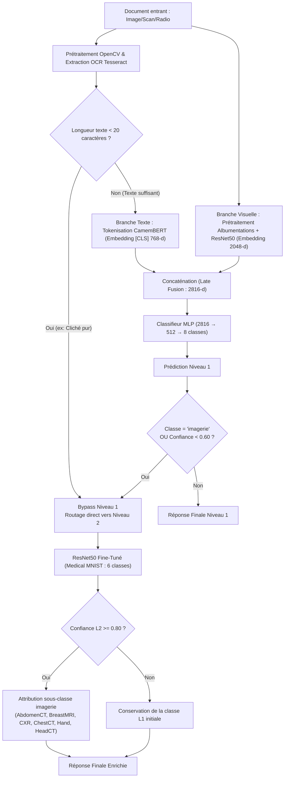

# Architecture du Projet & Pipeline d'Inférence

Ce document décrit l'organisation du projet ainsi que l'architecture technique du pipeline de classification multimodale hiérarchique.

---

## 1. Arborescence du Dépôt

```
multimodal-medical-document-classification/
├── app/
│   ├── __init__.py            # Initialisation du module Python
│   └── main.py                # Application FastAPI complète (chargement modèles, OCR, inférence L1/L2, endpoints)
├── frontend/
│   └── index.html             # Interface Web moderne (Drag & Drop, visualisation confiance, modalité d'imagerie)
├── notebook/
│   ├── Analyseexp_Phase1(ocr+ml).ipynb   # Phase 1 : Exploration, prétraitement OCR, baseline ML
│   └── notebookfa80748ae7 (14).ipynb     # Phases 2 à 4 : Transfer Learning ResNet50 & Fusion multimodale CamemBERT
├── weights/
│   └── README.md              # Documentation des fichiers de poids (.pt) requis
├── .gitignore                 # Exclusion des fichiers volumineux, .venv, Tesseract et caches
├── requirements.txt           # Dépendances Python nécessaires
├── ARCHITECTURE.md            # Ce document d'architecture technique
└── README.md                  # Documentation principale du projet
```

---

## 2. Pipeline de Classification Hiérarchique



---

## 3. Endpoints de l'API FastAPI

| Méthode | Route | Description | Entrée | Sortie |
|---|---|---|---|---|
| `GET` | `/health` | Statut du service et device actif (`cpu` ou `cuda`) | Aucune | `{"status": "ok", "device": "...", "model_version": "v1.0.0"}` |
| `GET` | `/version` | Version du modèle et listes des classes L1 / L2 | Aucune | `VersionResponse` avec nomenclature des 8 classes L1 et 6 classes L2 |
| `POST` | `/predict` | Inférence complète sur document téléversé | Fichier image (`image/png`, `image/jpeg`, etc.) | `PredictionResponse` (classe prédite, score, scores détaillés, sous-classe d'imagerie, temps ms) |
